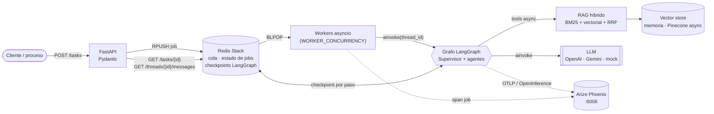
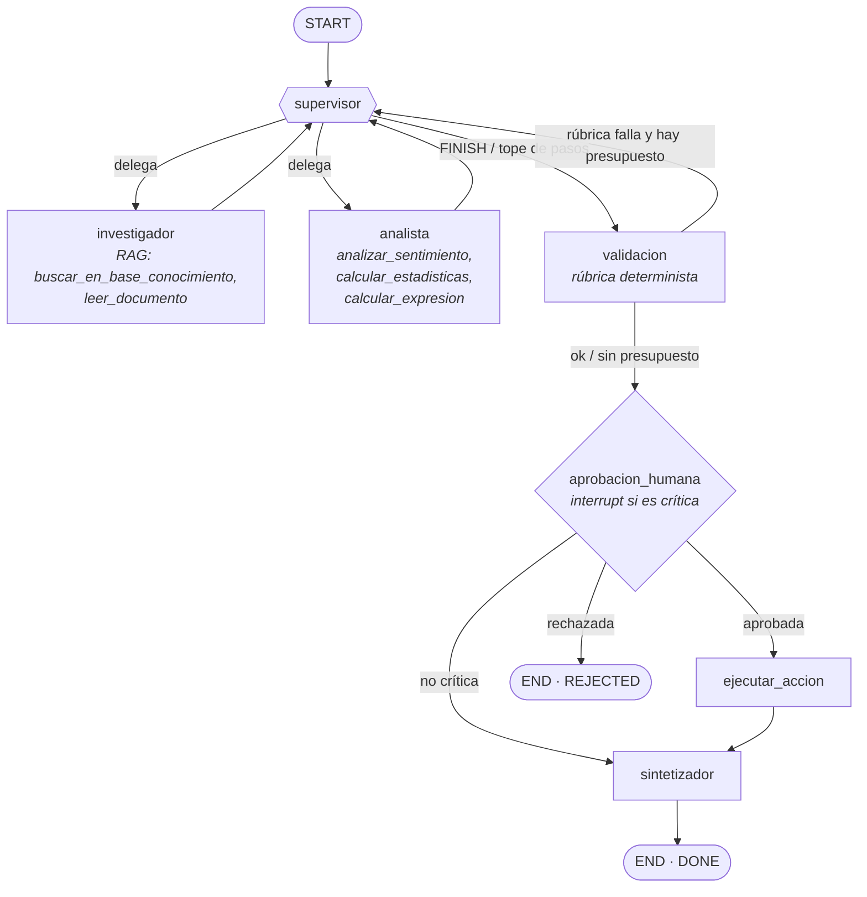
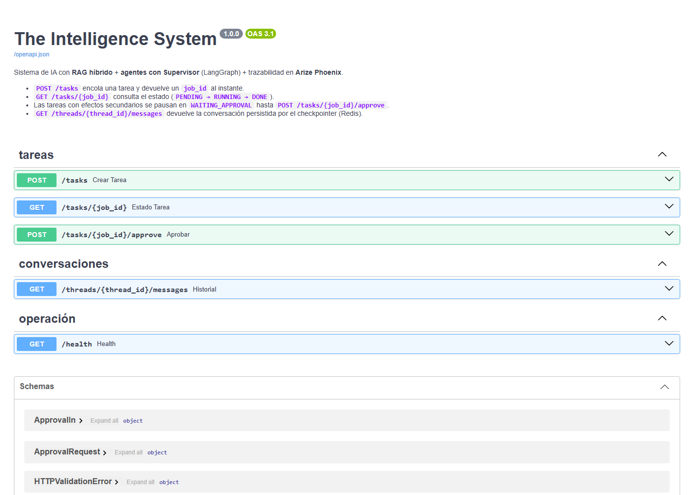
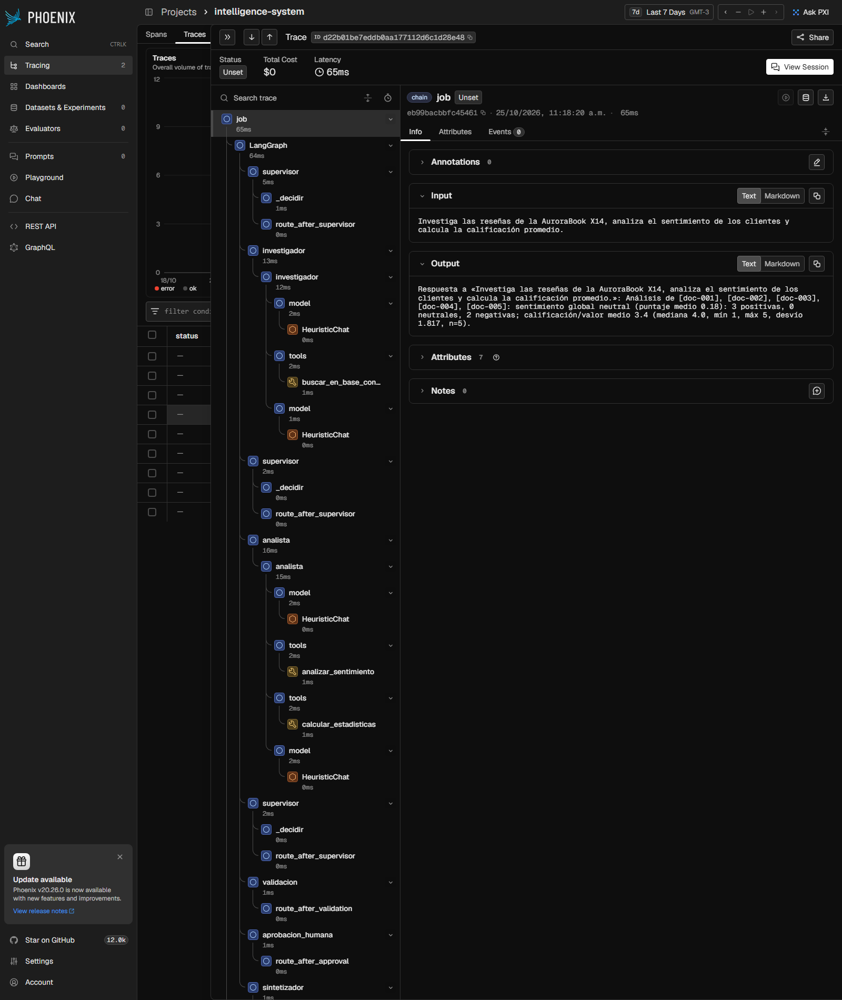
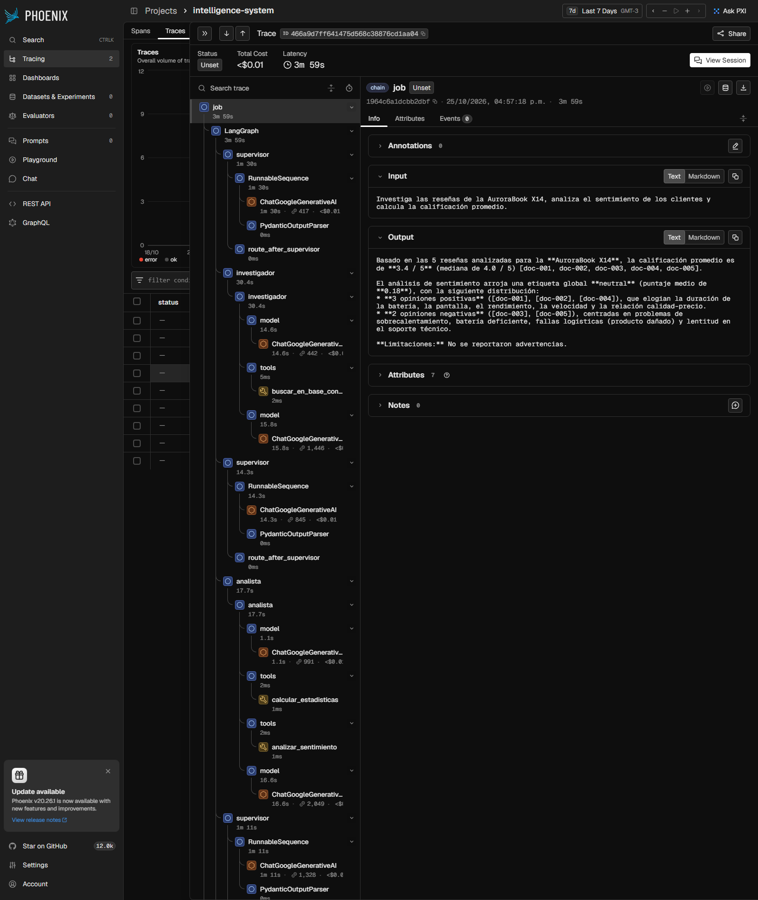

# The Intelligence System

Sistema de IA de grado de producción que resuelve tareas complejas combinando **conocimiento propio (RAG híbrido)**, **razonamiento multi-paso (agentes con Supervisor en LangGraph)**, una **API asíncrona documentada (FastAPI)** y **trazabilidad completa (Arize Phoenix)**.

> **Si tuviera que explicarlo en cinco minutos:** una petición HTTP no ejecuta nada, solo encola un *job* en Redis y responde al instante. Un worker `asyncio` toma el job y corre un grafo de LangGraph donde un **Supervisor** decide, paso a paso, si delega en el **Investigador** (que consulta la base de conocimiento con búsqueda híbrida BM25 + vectorial) o en el **Analista** (que calcula con herramientas, nunca "de cabeza"). Una **rúbrica determinista** valida el resultado antes de cerrar, y las acciones con efectos secundarios se **pausan para aprobación humana**. Cada paso se persiste en un **checkpointer en Redis** (las conversaciones sobreviven a un reinicio) y cada nodo, llamada al LLM y herramienta queda como un span en **Phoenix**. Todo el I/O es `async/await` y cada frontera (API, herramientas, configuración) se valida con **Pydantic**.

---

## Arquitectura



### Grafo de agentes



El mismo grafo, generado a partir del objeto compilado, está en [`docs/graph.mmd`](docs/graph.mmd) (`python scripts/export_graph.py`).

| Nodo | Responsabilidad |
|---|---|
| `supervisor` | El LLM propone una `Decision` (Pydantic: `investigador` / `analista` / `FINISH` + instrucción). Luego `aplicar_guardas` la corrige con reglas deterministas: tope de `MAX_STEPS=6`, el analista nunca antes de tener datos, `MAX_REVISIONS=1` por especialista. El flujo no depende solo del criterio del modelo. |
| `investigador` | Agente ReAct con dos herramientas sobre el RAG. Recibe solo la instrucción del supervisor (contexto aislado). |
| `analista` | Agente ReAct con herramientas de cómputo. Recibe solo la instrucción y las notas del investigador. |
| `validacion` | Rúbrica sin LLM: ¿hay datos citados `[doc-XXX]`?, ¿el analista usó herramientas?, ¿hay cifras? Si falla y queda presupuesto, vuelve al supervisor con el motivo. |
| `aprobacion_humana` | Si la tarea es crítica (verbos con efectos secundarios, o `require_approval=true`) llama a `interrupt()`: el estado queda en el checkpoint y el job pasa a `WAITING_APPROVAL`. |
| `sintetizador` | Redacta la respuesta final citando fuentes y reportando limitaciones si la rúbrica no se cumplió del todo. |

## Levantarlo con una sola instrucción

Requisito: Docker (Compose v2). **No hacen falta API keys**: por defecto `LLM_PROVIDER=mock` usa un modelo heurístico sin red (el RAG, las herramientas, el grafo, Redis y Phoenix son reales).

```bash
./run.sh            # crea .env desde .env.example si falta y ejecuta docker compose up --build
```

(equivalente: `cp .env.example .env && docker compose up --build`; en Windows sin bash, la segunda forma.)

| Servicio | URL |
|---|---|
| API + docs OpenAPI interactivas | http://localhost:8000/docs |
| Phoenix (trazas, latencias, sesiones) | http://localhost:6006 |

Para usar un LLM real, editá `.env`:

```env
LLM_PROVIDER=google        # o openai
GOOGLE_API_KEY=...         # o OPENAI_API_KEY
# opcional: embeddings reales y Pinecone
EMBEDDING_PROVIDER=google  EMBEDDING_DIMENSION=1536
VECTOR_BACKEND=pinecone    PINECONE_API_KEY=...
```

Sin Docker (Python ≥ 3.12 y un Redis **Stack** + Phoenix corriendo): `pip install -e ".[dev]"` y `uvicorn intelligence.api:app --port 8000`.

### Probarlo a mano

```bash
# 1) encolar (responde al instante con el job_id y el thread_id)
curl -X POST localhost:8000/tasks -H "Content-Type: application/json" \
  -d '{"query": "Investiga las reseñas de la AuroraBook X14, analiza el sentimiento y calcula la calificación promedio."}'

# 2) consultar el estado: PENDING -> RUNNING -> DONE
curl localhost:8000/tasks/<job_id>

# 3) tarea crítica: queda en WAITING_APPROVAL hasta que un humano decida
curl -X POST localhost:8000/tasks -H "Content-Type: application/json" \
  -d '{"query": "Reseñas de la AuroraBook X14 y envía un resumen por correo al equipo"}'
curl -X POST localhost:8000/tasks/<job_id>/approve -H "Content-Type: application/json" \
  -d '{"approved": true, "reviewer": "joaquin"}'        # approved:false -> REJECTED, sin efectos

# 4) conversación: mismo thread_id = misma memoria (persistida en Redis)
curl -X POST localhost:8000/tasks -H "Content-Type: application/json" \
  -d '{"query": "Ahora lo mismo para la NovaPad Pro", "thread_id": "ana-001"}'
curl localhost:8000/threads/ana-001/messages
```

## API

| Método y ruta | Descripción | Modelos (`intelligence/schemas.py`) |
|---|---|---|
| `POST /tasks` | Encola la tarea (`202`). `409` si el hilo ya tiene un job activo. | `TaskIn` → `TaskAccepted` |
| `GET /tasks/{job_id}` | Estado, resultado, error, solicitud de aprobación. | `JobOut` |
| `POST /tasks/{job_id}/approve` | Aprueba o rechaza un job en `WAITING_APPROVAL` (`409` si ya fue resuelto). | `ApprovalIn` → `TaskAccepted` |
| `GET /threads/{thread_id}/messages` | Conversación leída del checkpointer. | `ThreadHistory` |
| `GET /health` | Redis, documentos indexados, proveedor, tracing. | `HealthOut` |

Estados del job: `PENDING → RUNNING → (WAITING_APPROVAL → PENDING → RUNNING)* → DONE | REJECTED | FAILED`. Cualquier excepción deja el job en `FAILED` con el error, así que el polling siempre termina.



## Cómo se cumple cada requisito

**Async de punta a punta.** Entrada `async def` en la API; `redis.asyncio` para cola y estado; `grafo.ainvoke` y `ainvoke` en todos los nodos (supervisor, especialistas, sintetizador); herramientas `async`; embeddings por `aembed_*`; `PineconeAsyncio` para el vector store; `httpx.AsyncClient` en los scripts. No hay `requests` ni llamadas bloqueantes dentro de `async def`; la única tarea CPU-bound (BM25) corre en `asyncio.to_thread` y en paralelo (`asyncio.gather`) con la rama vectorial.

**Persistencia.** `AsyncRedisSaver` (LangGraph) guarda el estado tras cada paso bajo un `thread_id`. Redis corre con `appendonly yes` y volumen, así que sobreviven a `docker compose restart`. Esto habilita dos cosas: conversaciones multi-turno (cada turno reinicia los campos de control pero conserva `messages`) y pausas HITL que se reanudan con `Command(resume=...)` aunque el proceso se haya reiniciado. Se verifica con `scripts/persistence_check.py` y con un test que "reinicia" la app.

**Validación con Pydantic.** *API*: `TaskIn`, `ApprovalIn`, y `response_model` en todas las rutas. *Herramientas*: cada una declara `args_schema` (p. ej. `max_resultados` 1–10, `doc_id` con patrón `doc-\d{3}`, `valores` finitos y no vacíos, expresión ≤ 200 caracteres) y devuelve un modelo serializado (`BuscarOutput`, `EstadisticasOutput`…). *Decisión del supervisor*: `Decision` vía `with_structured_output`. *Configuración*: `Settings` (pydantic-settings) falla al arrancar si, por ejemplo, `LLM_PROVIDER=openai` y falta la clave.

**Sin hard-coding.** Proveedor y modelo del LLM, embeddings, índice/namespace/región de Pinecone, pesos de la fusión, URLs de Redis y Phoenix, concurrencia y timeouts salen de variables de entorno (ver `.env.example`).

## RAG híbrido

`intelligence/rag/`: la base (`data/knowledge_base.json`, 15 documentos de reseñas, ventas, políticas y arquitectura, con metadatos) se indexa al arrancar. Cada consulta ejecuta en paralelo **BM25** (tokenizador sin tildes y con stopwords) y **búsqueda vectorial**, y fusiona los rankings con **Reciprocal Rank Fusion ponderado** (`score = Σ peso / (60 + rango)`). Cada resultado informa qué rama lo encontró y admite filtro por `categoria` (filtro de metadata también en Pinecone).

- `EMBEDDING_PROVIDER=local` (por defecto): *feature hashing* de palabras y trigramas, determinista y sin red. Captura similitud morfológica, **no semántica**; es para correr offline. Con `openai`/`google` los embeddings son neuronales.
- `VECTOR_BACKEND=memory` (por defecto) o `pinecone`.

## Observabilidad: pruebas y trazas

`init_observability()` registra un exportador OTLP hacia Phoenix e instrumenta LangChain/LangGraph con OpenInference. Cada job es **una traza** con un span raíz `job` (`session.id` = `thread_id`, para ver conversaciones completas en *Sessions*), un span por nodo del grafo, por llamada al LLM (tokens y modelo → costo, con un proveedor real), por herramienta y un span `rag.search` de tipo `RETRIEVER` con los documentos recuperados y sus scores.

`python scripts/run_scenarios.py` ejecuta **6 pruebas de punta a punta, en paralelo**, contra el sistema real (Docker Compose: API + Redis Stack + Phoenix). Resultados con el LLM `mock`; más abajo, la corrida con LLM real:

| # | Prueba | Resultado esperado y obtenido |
|---|---|---|
| 1 | Reseñas AuroraBook X14: sentimiento + calificación promedio | `DONE` · media 3.4/5, sentimiento neutral |
| 2 | Ventas AuroraBook X14: unidades totales e ingreso | `DONE` · 4 050 unidades, 3 847 500 USD |
| 3 | Reseñas NovaPad Pro | `DONE` · media 3.5/5, sentimiento positivo |
| 4 | Tarea crítica ("…y envía un resumen por correo") | `WAITING_APPROVAL` → aprobada → `DONE` con `ejecutar_accion` |
| 5 | Tarea crítica ("…y publica el resultado") | `WAITING_APPROVAL` → rechazada → `REJECTED`, sin efectos |
| 6 | Multi-turno en un mismo hilo | `DONE`, el hilo conserva ambas preguntas |

Evidencia en Phoenix (proyecto `intelligence-system`):

| Captura | Qué muestra |
|---|---|
| [`01-trazas.png`](docs/screenshots/01-trazas.png) | Una traza por job; las dos con salida vacía son las pausadas en HITL. |
| [`02-traza-grafo-resenas.png`](docs/screenshots/02-traza-grafo-resenas.png) | Árbol de spans de la prueba 1: `job → LangGraph → supervisor → investigador → model / tools (buscar_en_base_conocimiento) → …`. |
| [`03-traza-hitl-aprobada.png`](docs/screenshots/03-traza-hitl-aprobada.png) | Reanudación tras la aprobación: `aprobacion_humana → ejecutar_accion → sintetizador`. |
| [`04-traza-hitl-rechazada.png`](docs/screenshots/04-traza-hitl-rechazada.png) | Rechazo: el grafo termina en `aprobacion_humana` sin ejecutar ninguna acción. |
| [`05-sesiones.png`](docs/screenshots/05-sesiones.png) | Vista *Sessions*: cada hilo agrupa sus trazas (el job pausado y su reanudación; los dos turnos de `demo-…`). |
| [`06-spans.png`](docs/screenshots/06-spans.png) | Spans raíz del proyecto con el panel de totales: 9 trazas, latencia P50 266 ms / P99 288 ms. |



### Corrida con LLM real (Gemini)

Las mismas 6 pruebas, ejecutadas en paralelo con `LLM_PROVIDER=google` y `LLM_MODEL=gemini-3.5-flash-lite` (plan gratuito, `LLM_REQUESTS_PER_MINUTE=4`), contra el stack completo en Docker: **6/6 OK** y las mismas cifras que con el mock (media 3.4/5, 4 050 unidades, media 3.5/5), esta vez redactadas por el modelo con sus citas `[doc-XXX]`.

| Métrica (Phoenix, proyecto `intelligence-system`) | Valor |
|---|---|
| Pruebas / estado final | 6 / `DONE` ×4, `REJECTED` ×1 (HITL), multi-turno `DONE` |
| Latencia extremo a extremo por prueba | 185 s – 425 s (las 6 en paralelo; p95 ≈ máx = 425 s) |
| Llamadas al LLM | 57 (supervisor, investigador, analista, sintetizador) |
| Tokens | 50 417 (42 543 de entrada, 7 874 de salida) |
| Costo estimado por Phoenix | ≈ US$ 0,03 en total (≈ US$ 0,005 por ejecución; en el plan gratuito no se cobra) |

La latencia es alta porque el plan gratuito de Gemini se limita a pocas peticiones por minuto y cada ejecución encadena ~9 llamadas secuenciales; la API sigue respondiendo `202` al instante. Con un plan pago se espera una fracción de ese tiempo.

| Captura | Qué muestra |
|---|---|
| [`08-llm-real-traza.png`](docs/screenshots/08-llm-real-traza.png) | Árbol de spans de la prueba 1 con Gemini: `supervisor → ChatGoogleGenerativeAI + PydanticOutputParser`, `investigador → buscar_en_base_conocimiento`, `analista → calcular_estadisticas / analizar_sentimiento`, con **tokens y costo por llamada**. |
| [`09-llm-real-metricas.png`](docs/screenshots/09-llm-real-metricas.png) | Pestaña *Metrics*: latencia por percentiles, costo y uso de tokens por modelo. |
| [`10-llm-real-trazas.png`](docs/screenshots/10-llm-real-trazas.png) | Una traza por job del proyecto. |



> Las capturas `01`–`06` corresponden a una corrida previa con `LLM_PROVIDER=mock` (sin tokens, costo `$0`); sirven para ver la estructura de trazas sin ninguna clave. Las `08`–`10` son con el LLM real.

### Corrida completa: Gemini + embeddings de Google + Pinecone

Además de la corrida anterior, las 6 pruebas se repitieron con **todo real**: `LLM_PROVIDER=google`, `EMBEDDING_PROVIDER=google` (`gemini-embedding-001`, 1536 dimensiones) y `VECTOR_BACKEND=pinecone` (índice serverless `intelligence-kb`, métrica coseno, namespace `productos-es`, creado por `PineconeVectorStore` con `PineconeAsyncio`). Resultado: **6/6 OK** (`DONE` ×5 incluida la multi-turno, `REJECTED` ×1), 394 s la más lenta de las tareas simples y 450 s la multi-turno (plan gratuito), 58 llamadas al LLM, 50 432 tokens, 7 búsquedas `rag.search` contra Pinecone. El log de arranque confirma `API lista: llm=google vector=pinecone` y el índice quedó `Ready` con 15 vectores.

Con embeddings neuronales la rama vectorial aporta recall semántico real: la consulta *"cuánto tardan en reembolsar una compra"* recupera la política de devoluciones (`doc-012`) aunque no comparte palabras con ella, y *"el equipo se calienta mucho y la batería dura poco"* recupera la reseña negativa (`doc-003`).

| Captura | Qué muestra |
|---|---|
| [`11-pinecone-traza.png`](docs/screenshots/11-pinecone-traza.png) | Traza de la prueba 1 con LLM, embeddings y vector store reales. |
| [`12-pinecone-metricas.png`](docs/screenshots/12-pinecone-metricas.png) | Métricas de la corrida: latencia, costo y tokens. |

Para reproducirlo: en `.env`, `LLM_PROVIDER=google`, `GOOGLE_API_KEY`, `EMBEDDING_PROVIDER=google`, `EMBEDDING_DIMENSION=1536`, `VECTOR_BACKEND=pinecone`, `PINECONE_API_KEY`. El índice se crea solo si no existe.

### Persistencia tras reinicio (verificada)

```bash
python scripts/persistence_check.py create   # turno 1 en el hilo "demo-persistencia"
docker compose restart api                   # reinicia SOLO la API
python scripts/persistence_check.py verify   # el hilo conserva 8 mensajes y acepta el turno 2
```

## Tests

```bash
pip install -e ".[dev]" && pytest -q       # 35 tests, sin red, sin API keys, sin Redis ni Phoenix reales
```

Cubren el RAG (fusión, filtros, idempotencia de la indexación), la validación de herramientas (entradas inválidas rechazadas, cálculo seguro frente a `__import__`, `9**99`, `1/0`), el grafo (flujo completo, memoria multi-turno, HITL con aprobación y rechazo, reconstrucción del grafo con el mismo checkpointer, guardas y rúbrica) y la API (validación `422`, `409` por hilo ocupado o doble aprobación, `FAILED` ante una excepción, y **conversación que persiste tras reiniciar la aplicación**). Usan `fakeredis`, `MemorySaver` y el LLM mock.

## Decisiones de diseño

- **Cola en Redis + workers asyncio en vez de `BackgroundTasks`:** la cola sobrevive al proceso de la API y la concurrencia se acota con `WORKER_CONCURRENCY`. Para escalar basta con más réplicas de la API, o mover `worker.py` a un proceso aparte.
- **Un job activo por hilo:** dos ejecuciones concurrentes sobre el mismo `thread_id` se pisarían el checkpoint; un lock `SET NX` en Redis lo evita (`409`). El lock se libera al terminar el job (no en `WAITING_APPROVAL`).
- **Guardas deterministas sobre el LLM:** el supervisor propone, el código dispone (tope de pasos, orden lógico, revisiones). Evita el "Supervisor infinito" y acota el costo por ejecución.
- **Contexto aislado por especialista:** cada agente recibe solo lo mínimo (instrucción + notas), no el historial del sistema; menos tokens y menos contaminación entre agentes.
- **Idempotencia del nodo HITL:** al reanudar, el nodo se re-ejecuta desde el inicio; por eso antes de `interrupt()` no hay efectos secundarios (la acción real vive en `ejecutar_accion`, posterior a la aprobación).
- **Mock heurístico, no un guion fijo:** `HeuristicChat` decide según lo que ya aportaron los agentes y lo que devolvieron las herramientas (que sí se ejecutan).
- **Spans HTTP nativos de FastAPI desactivados:** Phoenix muestra una traza por job, sin el ruido del polling a `GET /tasks/{id}`.

## Limitaciones conocidas

- El camino por defecto (`memory` + embeddings `local`) es el de `run.sh` sin claves; la combinación Pinecone + embeddings neuronales requiere claves propias (ver la corrida verificada más arriba).
- Un job que estaba `RUNNING` cuando el proceso muere queda en ese estado (no hay recuperación automática); su lock de hilo expira a la hora. Los jobs `WAITING_APPROVAL` sí se reanudan tras un reinicio.
- El análisis de sentimiento es un léxico en español simple (suficiente para demostrar la herramienta, no un modelo de producción).
- El despliegue es local (Docker Compose); no incluye CI/CD ni infraestructura cloud, que quedan fuera del alcance de la entrega.

## Estructura

```
intelligence/
├── api.py             # FastAPI: rutas, lifespan (RAG, checkpointer, workers)
├── schemas.py         # contratos Pydantic de la API
├── config.py          # Settings (pydantic-settings): todo viene del entorno
├── store.py           # JobStore: estado, cola y locks en Redis (async)
├── worker.py          # consume la cola, corre el grafo, FAILED ante excepción
├── observability.py   # Phoenix / OpenInference + tracer propio
├── llm/               # fábrica de LLMs (openai · google) y modelo mock heurístico
├── rag/               # modelos, embeddings, vector stores, búsqueda híbrida (BM25 + RRF)
├── agents/            # investigador (RAG) y analista, con herramientas validadas
└── graph/             # estado, supervisor + guardas, validación, HITL, ensamblado del grafo
data/knowledge_base.json
scripts/               # run_scenarios.py · persistence_check.py · export_graph.py
tests/                 # 35 tests
docs/                  # graph.mmd + screenshots/
Dockerfile · docker-compose.yml · run.sh · pyproject.toml · .env.example
```

Python **3.12+** (`requires-python = ">=3.12"`; la imagen Docker usa `python:3.12-slim`). Dependencias en `pyproject.toml`.
